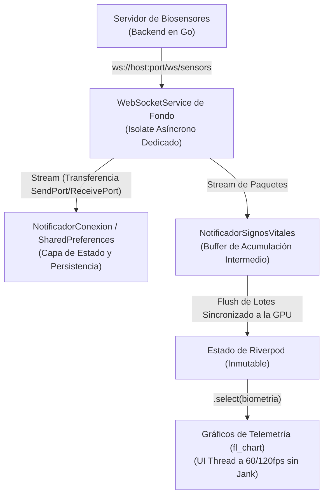

# Arquitectura de WebSocket de Alta Frecuencia y Rendimiento en Tiempo Real

Este documento detalla el diseño, la implementación y los mecanismos de optimización aplicados al flujo de datos por WebSockets en **DataVital**. Explica el porqué de cada decisión técnica tomada para asegurar una visualización médica robusta, fluida y con latencia mínima, garantizando una tasa de refresco constante libre de congelamientos (*jank-free*).

---

## 📡 1. El Desafío del Tiempo Real y la Frecuencia Crítica

En sistemas de monitoreo de bioseñales (como electrocardiogramas ECG, saturación de oxígeno SpO₂ y dióxido de carbono CO₂), el hardware sensor (ej. Arduino) envía telemetría a alta frecuencia. Nuestro backend procesa y despacha paquetes individuales cada **~80ms**, lo que equivale a recibir múltiples flujos continuos que golpean constantemente al cliente.

Si el cliente móvil o desktop maneja esto de forma ingenua, surgen dos grandes problemas de rendimiento:
1. **Bloqueo del Hilo de UI (Jank)**: Analizar textos JSON y parsear objetos consume ciclos en el hilo principal (*UI Thread*), compitiendo contra la animación y dibujado gráfico de la interfaz de usuario.
2. **Saturación del Recolector de Basura (Garbage Collection)**: El instanciar, modificar y desechar constantemente listas de puntos para alimentar las gráficas genera millones de micro-objetos en la memoria Heap, forzando detenciones periódicas para liberar memoria.

---

## 🏗️ 2. Arquitectura de Tres Capas y sus Mecanismos

Para mitigar estos desafíos, la arquitectura se estructuró en tres capas especializadas, cada una con un rol optimizado:



---

## 🛠️ 3. Mecanismos de Optimización Aplicados

### A. Isolate de Red de Fondo (`Background Net Isolate`)
* **Qué hace**: Se desplaza toda la lógica de conexión TCP, handshake de comunicación, manejo de reconexiones automáticas y buffering intermedio a un hilo físico dedicado en background de la máquina virtual de Dart (**Dart Isolate**).
* **Por qué se implementó**: Libera por completo de tareas imperativas de entrada/salida (I/O) al hilo de pintado primario (*UI Thread*), eliminando congelamientos de pantalla a frecuencias superiores a los 200 Hz.

---

### B. Reconexión con Algoritmo de Backoff Exponencial
* **Qué hace**: Si la conexión con el servidor WebSocket se interrumpe (fallo de red, reinicio del backend), la app no intenta conectarse de manera inmediata e infinita. En su lugar, calcula una espera progresiva: $1\text{s} \rightarrow 2\text{s} \rightarrow 4\text{s} \rightarrow 8\text{s} \rightarrow \dots \rightarrow 30\text{s}$ (máximo).
* **Por qué se implementó**: Evita la saturación de CPU local provocada por un bucle infinito de reconexiones fallidas y previene un ataque de denegación de servicio involuntario (DDoS) al backend cuando este intente volver a levantarse.

---

### C. Transmisión Multi-oyente mediante Broadcast Streams
* **Qué hace**: El `WebSocketService` expone un `StreamController.broadcast()`.
* **Por qué se implementó**: Permite que múltiples componentes independientes de la aplicación (el gráfico ECG, los KPI paneles de la barra lateral, los disparadores de alarma y el grabador de sesiones médicas) escuchen la misma tubería de datos WebSocket simultáneamente sin necesidad de instanciar o abrir conexiones paralelas de red TCP.

---

### D. Sincronización Sincronizada a Nivel de Fotograma (`SchedulerBinding`)
* **Qué hace**: En lugar de utilizar temporizadores tradicionales de tiempo fijo (`Timer.periodic` de ~80ms), el vaciado del acumulador de paquetes a Riverpod se sincroniza directamente con el callback del motor gráfico de Flutter `SchedulerBinding.instance.addPostFrameCallback`.
* **Por qué se implementó**: Sincroniza la mutación del estado y el redibujado de las curvas en estricta coherencia con la tasa de refresco del panel físico del dispositivo (60Hz / 90Hz / 120Hz). Esto previene que se redibujen datos invisibles para el ojo humano y congela automáticamente la telemetría en segundo plano, maximizando el ahorro de batería.

---

### E. Reconstrucción Granular Basada en Selectores (`.select()`)
* **Qué hace**: Los widgets de gráficos y KPI de DataVital no observan el estado general con un simple `ref.watch(provider)`. En su lugar, utilizan selectores selectivos como `ref.watch(provider.select((s) => s.ecgDatos))`.
* **Por qué se implementó**: Asegura que el gráfico de electrocardiogramas no se entere ni se redibuje cuando llega un paquete de SpO₂ o cuando cambia el nivel de CO₂ de la sala. El árbol de widgets del sistema sólo redibuja el sub-nodo exacto que sufrió variaciones físicas de lectura.

---

### F. Aislamiento Gráfico mediante `RepaintBoundary`
* **Qué hace**: Los widgets envolventes de los gráficos de bioseñales (`fl_chart`) están envueltos en `RepaintBoundary`.
* **Por qué se implementó**: Esto crea una subcapa en el motor de renderizado de Flutter (Skia o Impeller). Cuando las curvas de las ondas ECG o SpO₂ se actualizan, el framework redibuja únicamente la textura del gráfico de forma aislada, evitando invalidar y redibujar estáticamente el dashboard completo, los textos de los botones de grabación o el menú lateral de navegación.

---

### G. Transiciones Instantáneas con `Duration.zero`
* **Qué hace**: Se deshabilita cualquier tipo de animación implícita de transición en las líneas de fl_chart asignando `Duration.zero` al repintado.
* **Por qué se implementó**: El comportamiento por defecto de fl_chart es interpolar y animar el movimiento de los puntos. En una señal de alta frecuencia biométrica esto genera retraso artificial (lag) y desfase visual respecto al tiempo real de los sensores Arduino.

---

## 📝 4. Estructura de Datos de Telemetría

Cada paquete transmitido por el backend e interpretado por el servicio de red de DataVital mapea el siguiente objeto de datos inmutable de alto rendimiento:

```dart
@immutable
class WsPacket {
  final String type;      // Tipo de señal: "bpm", "spo2", "ecg"
  final double value;     // Valor físico de lectura
  final int timestamp;    // Unix Epoch en milisegundos
}
```

Este formato minimalista garantiza que el parsing JSON directo a través de `jsonDecode` consuma microsegundos de tiempo de cómputo, logrando un balance óptimo entre latencia de transporte y consumo de batería en el dispositivo móvil del personal de salud.
